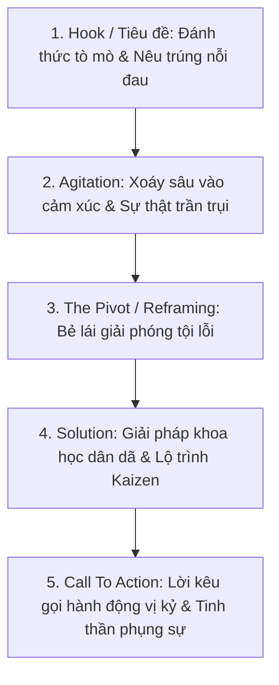

# 🎯 KỸ NĂNG COPYWRITING CHUYỂN ĐỔI CAO & CHỐNG VĂN MẪU AI
> **Nguồn gốc:** Chuẩn hóa từ repository mã nguồn mở hàng đầu thế giới `coreyhaines31/marketingskills`.  
> **Áp dụng cho:** Agent 1 (Content Architect), Agent 2 (Media Scriptwriter), Agent 7 (Social Media Facebook) và Mây.

---

## 1. 🛑 BỘ QUY TẮC "NO AI TELLS" (TRIỆT TIÊU 100% VĂN MẪU MÁY MÓC)

Độc giả hiện đại rất nhạy cảm và sẽ rời bỏ ngay những nội dung sặc mùi "AI viết". Khi viết, AI bắt buộc phải loại bỏ các "vết tích" sau:

### 1.1. CÁC CẤU TRÚC TUYỆT ĐỐI CẤM (NEVER WRITE THESE)
1. **Kiểu câu tương phản giả tạo (Contrast reveals):**
   * ❌ *"Nó không phải là X, nó là Y"*
   * ❌ *"Không chỉ là X, mà còn là Y"*
   * ❌ *"Không phải vì X, mà là vì Y"*
   * 👉 **Cách sửa:** Nói thẳng trực tiếp điều Y cùng lý do cụ thể.
2. **Danh sách phủ định dồn dập (Negation lists):**
   * ❌ *"Không cần kỷ luật thép, không cần dậy từ 4h sáng, không cần ngồi thiền khổ hạnh..."*
   * 👉 **Cách sửa:** Nói thẳng những gì sẽ diễn ra và hành động cụ thể cần làm.
3. **Câu đuôi dồn dập (Trailing pile-ons):**
   * ❌ Câu đã nói xong ý chính nhưng cứ chêm thêm phẩy và các vế kéo dài lê thê: *"...giúp bạn lấy lại sự tập trung, không xao nhãng, không lướt máy, không mất thời gian vô ích."*
   * 👉 **Cách sửa:** Chấm dứt câu dứt khoát ngay tại điểm nhấn chính.
4. **Kiểu tự hỏi tự trả lời kịch tính giả tạo (Self-answered questions & Colon reveals):**
   * ❌ *"Kết quả là gì? Bạn mất 2 tiếng mỗi ngày."*
   * ❌ *"Điều tuyệt vời nhất: não bạn tự phục hồi."*
   * 👉 **Cách sửa:** Trình bày tự nhiên, không diễn kịch kịch tính hóa.
5. **Các câu mở đầu sáo mòn (Stock openers & Clichés):**
   * ❌ *"Trong thế giới vội vã ngày nay..."*
   * ❌ *"Trong kỷ nguyên số bùng nổ..."*
   * ❌ *"Dù bạn là ai, một nhân viên văn phòng hay một sinh viên..."*
   * ❌ *"Khai phá sức mạnh tiềm ẩn của..."*
   * ❌ *"Nâng tầm cuộc sống của bạn..."*
   * ❌ *"Nói lời tạm biệt với..."*
   * 👉 **Cách sửa:** Đi thẳng vào một khung cảnh đời thực, một con số cụ thể hoặc một cảm giác chân thực.
6. **Lạm dụng dấu gạch ngang dài (Em dashes `—`):**
   * Không dùng em dash trong tiêu đề, câu ngắn, subhead hoặc bài đăng ngắn mạng xã hội.

### 1.2. HẠN CHẾ TỐI ĐA (KEEP THESE RARE)
* **Từ ngữ sáo rỗng vô thưởng vô phạt:** *Đột phá, tối ưu hóa, liền mạch, mạnh mẽ, toàn diện, thần kỳ*. Thay thế bằng **sự thật cụ thể** mà từ đó đại diện.
* **Quy tắc Kiểm tra Hoán đổi (The Swap Test):**
  * Nếu một câu văn hay tiêu đề có thể đem dán sang bất kỳ một fanpage hay website nào khác mà vẫn thấy "hợp lý", thì câu đó là **văn mẫu sáo rỗng**. Bắt buộc phải viết lại với các chi tiết, cảm xúc và bối cảnh độc bản chỉ có ở Trại Cai Nghiện.

---

## 2. 💎 NGUYÊN TẮC VÀNG TRONG COPYWRITING

### 2.1. Rõ Ràng Trên Hết, Không Cần Hoa Mỹ (Clarity Over Cleverness)
* Đừng cố tỏ ra văn hoa hay thông thái.
* Mục tiêu của câu chữ là giúp người đọc hiểu ngay trong 2 giây mà không cần phải nhíu mày suy nghĩ.

### 2.2. Lợi Ích > Tính Năng (Benefits Over Features)
* Không nói: *"Bài viết cung cấp 5 kỹ thuật khoa học thần kinh"* (Tính năng).
* Nói: *"Tối nay bạn sẽ không còn cảm giác bứt rứt phải với tay cầm điện thoại lúc 11h đêm"* (Lợi ích sát sườn).

### 2.3. Cụ Thể > Mơ Hồ (Specificity Over Vagueness)
* ❌ *"Tiết kiệm nhiều thời gian làm việc"*
* ✅ *"Rút ngắn từ 4 tiếng làm việc uể oải xuống còn 90 phút tập trung sâu"*

### 2.4. Ngôn Ngữ Khách Hàng > Ngôn Ngữ Chuyên Gia (Customer Language Over Company/Academic)
* Dùng chính xác từ ngữ mà người đọc tự nói thầm trong đầu lúc 2h sáng: *"mắt cay xè", "đầu nhức như búa bổ", "quẹt vu vơ", "nghẹn ứ ở cổ họng"*.
* Tuyệt đối không dùng thuật ngữ hàn lâm trừ khi đã được dân dã hóa bằng một ví dụ đời thường.

---

## 3. 🏗️ CẤU TRÚC BÀI VIẾT & CHUYỂN ĐỔI CHUẨN MỰC

### 3.1. Tiêu Đề & Hook (The Hook)
* Gợi mở một nghịch lý hoặc hình tượng đời thường độc đáo.
* Độ dài tiêu chuẩn: **50 – 62 ký tự** (hiển thị trọn vẹn 2 dòng, không bao giờ bị cắt cụt).

### 3.2. Lời Kêu Gọi Hành Động (CTA Guidelines)
* **Vị kỷ (Self-interested):** Nêu bật việc người đọc **nhận được sự tự do và bình an** gì khi thực hiện, thay vì ra lệnh ép buộc.
* **Giảm thiểu ma sát (Frictionless):** Hướng dẫn bước đi đầu tiên nhỏ nhất có thể (chỉ mất 1-2 phút, ví dụ: để điện thoại xa 2 mét, thở 3 nhịp).
