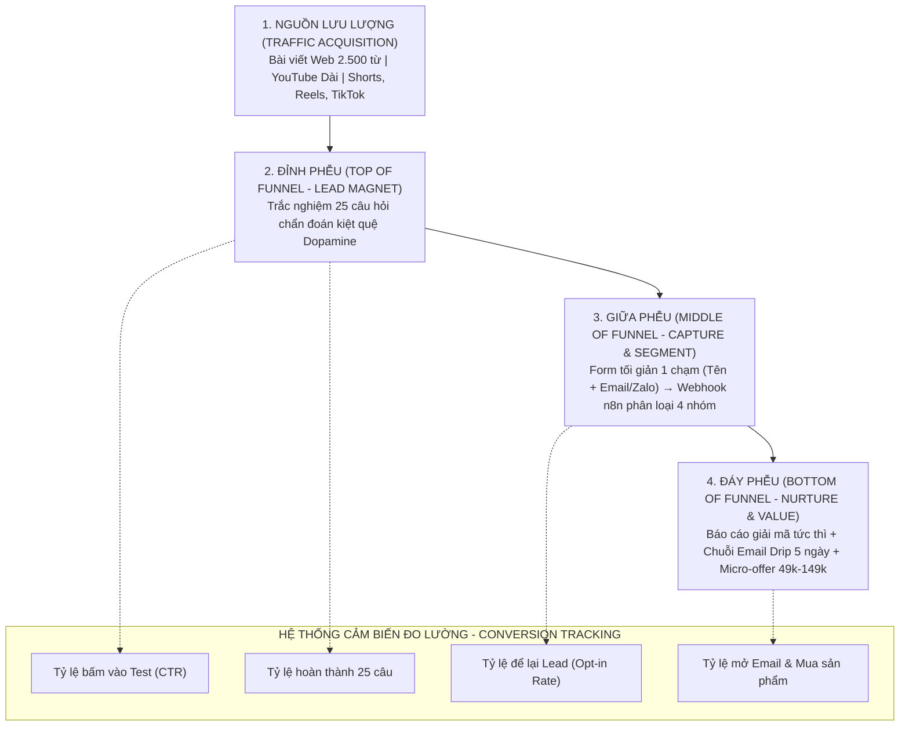

# 🌪️ KIẾN TRÚC PHỄU DỮ LIỆU & TỐI ƯU HÓA CHUYỂN ĐỔI WEBSITE (WEBSITE DATA FUNNEL & LEAD ARCHITECTURE)
> **Chịu trách nhiệm:** **Agent 3 (Product & Funnel Architect)** & **Agent 7 (Lead Intelligence & Retargeting)**  
> **Phối hợp kỹ thuật:** **Agent 4** (Web Engineer) & **Agent 9** (Webhook n8n)  
> **Nền tảng tri thức:** Đúc kết từ tiêu chuẩn quốc tế của `coreyhaines31/marketingskills` (các module: *lead-magnets, cro, signup, conversion-tracking, emails*) và `wondelai/skills`.

---

## 1. 🏛️ BẢN ĐỒ KIẾN TRÚC 4 TẦNG PHỄU DỮ LIỆU (THE 4-STAGE DATA FUNNEL)

---

## 2. 🧲 NGUYÊN TẮC THIẾT KẾ MỒI CÂU DỮ LIỆU ĐỈNH CAO (LEAD MAGNET PRINCIPLES)
*(Chuẩn hóa từ `coreyhaines31/marketingskills/lead-magnets`)*

Một Lead Magnet hiệu quả phải biến người đọc vãng lai thành người dùng tự nguyện cung cấp dữ liệu bằng 5 quy tắc vàng:

1. **Giải quyết đúng 1 vấn đề cụ thể (Solve One Specific Problem):**
   * ❌ Không tặng: *"Bộ tài liệu phát triển bản thân toàn diện 500 trang"* (người dùng sợ hãi, không bao giờ đọc).
   * ✅ Tặng: *"Bản đồ 7 ngày tái lập thụ thể Dopamine & dứt điểm chứng lướt điện thoại đêm"* hoặc *"Bài trắc nghiệm chẩn đoán mức độ kiệt quệ dopamine"*.
2. **Khớp với giai đoạn nhận thức (Match Awareness Stage):** Người dùng ở tầng nhận thức vấn đề (*Problem-Aware*) cần công cụ giúp họ **nhìn thấu bản thân**, chứ chưa sẵn sàng mua khóa học.
3. **Giá trị cảm nhận cực cao nhưng tiêu tốn ít thời gian (High Perceived Value, Low Time Investment):** Người dùng chỉ cần bỏ ra 3–5 phút làm trắc nghiệm là nhận lại được kết quả giải phẫu tâm lý chi tiết.
4. **Cầu nối tự nhiên vào sản phẩm (Natural Path to Product):** Kết quả trắc nghiệm tự động chỉ ra mắt xích thói quen bị gãy, tạo lý do hoàn hảo để họ cần đến sản phẩm vi mô (như *Dopamine Menu Notion* giá 49k).

---

## 3. 📝 TỐI ƯU HÓA FORM ĐĂNG KÝ & TRIỆT TIÊU MA SÁT (FORM CRO & SIGNUP MASTERY)
*(Chuẩn hóa từ `coreyhaines31/marketingskills/signup` & `cro`)*

Hơn 68% khách truy cập từ bỏ form nếu cảm thấy bị làm phiền. Agent 3 & Agent 7 bắt buộc áp dụng:

* **Kỹ thuật Progressive Profiling (Trắc nghiệm từng bước):**
  * Không đưa form điền ngay từ đầu. Hãy để người dùng trả lời 25 câu trắc nghiệm mượt mà bằng các nút bấm 1 chạm. Khi họ đã đầu tư công sức trả lời xong (Hiệu ứng Sunk Cost), họ sẽ rất sẵn lòng điền Email để nhận kết quả phân tích.
* **Tối giản trường thông tin (Frictionless Input):**
  * **Chỉ yêu cầu đúng 2 thông tin:** Họ tên (để xưng hô ấm áp) + Địa chỉ Email (hoặc Zalo).
  * Tuyệt đối không bắt nhập mật khẩu, ngày sinh, hay địa chỉ rườm rà.
* **Tín hiệu an tâm & Động lực nhận quà (Trust & Value Copy):**
  * Ngay dưới nút Submit, đặt dòng cam kết: *"🌿 Trại Cai Nghiện bảo mật tuyệt đối thông tin của bạn. Không spam, hủy nhận tin bất kỳ lúc nào."*
  * **Nút bấm hành động (Action-driven CTA):** Thay vì chữ *"Gửi"* vô hồn, dùng: *"Gửi báo cáo phân tích cho tôi ngay →"*.

---

## 4. 🏷️ KỊCH BẢN PHÂN LOẠI DATA TỰ ĐỘNG (4 CHÂN DUNG KHÁCH HÀNG)
Khi data được gửi về qua Webhook n8n, hệ thống tự động tính điểm trắc nghiệm và gắn thẻ Tag phân loại:

1. **Tag `NHOM_1_PHO_THONG` (Dưới 30 điểm):** Mức độ nhẹ, chỉ xao nhãng nhất thời $\rightarrow$ Nuôi dưỡng bằng các bài viết thói quen nhẹ nhàng, chia sẻ kinh nghiệm sống chậm.
2. **Tag `NHOM_2_THIEU_DONG_LUC` (30 - 55 điểm):** Biết mình nghiện nhưng thiếu lý do cốt lõi (*Why*) $\rightarrow$ Gửi chuỗi bài về Ikigai, đánh thức ước mơ và tìm lại ngọn lửa sống.
3. **Tag `NHOM_3_KIET_QUE_DOPAMINE` (55 - 75 điểm):** Lo âu, mất ngủ, sương mù não, hay cáu gắt $\rightarrow$ Thức tỉnh căn nguyên do thiếu hụt dopamine, hướng dẫn giao thức thanh lọc não bộ 90 phút.
4. **Tag `NHOM_4_HAY_TAI_NGHIEN` (Trên 75 điểm):** Đã thử bỏ nhiều lần nhưng thất bại, bế tắc $\rightarrow$ Trao phương pháp Kaizen 1%, tinh thần Wabi Sabi tha thứ bản thân và đề xuất sản phẩm vi mô đồng hành chuyên sâu.

---

## 5. 📧 CHUỖI EMAIL NUÔI DƯỠNG TỰ ĐỘNG 5 NGÀY (WELCOME & NURTURING DRIP)
*(Chuẩn hóa từ `coreyhaines31/marketingskills/emails`)*

* **Email 1 (Ngay lập tức):** Gửi Bản báo cáo kết quả trắc nghiệm chi tiết + Lời chào mừng ấm áp từ Bố & Mây.
* **Email 2 (Sau 24h):** Câu chuyện tự sự trần trụi (*"Bố con mình cũng từng có những đêm quẹt điện thoại tới 2h sáng cay xè mắt..."*).
* **Email 3 (Sau 48h):** Cú bẻ lái giải phóng tội lỗi (*"Bạn không hề lười biếng, bạn chỉ đang là nạn nhân của thuật toán công nghiệp"*).
* **Email 4 (Sau 72h):** Trao giải pháp Kaizen 1% thực chiến (*Quy tắc để điện thoại cách xa 2m, thiết kế môi trường sống Atomic Habits*).
* **Email 5 (Sau 96h):** Giới thiệu sản phẩm số vi mô hỗ trợ tự lực (*Bộ Notion Dopamine Menu & Sổ tay hành vi 49k - 149k*) với tinh thần phụng sự thuần khiết, thanh toán quét QR tự động nhận file trong 30 giây.

---

## 6. 📊 HỆ THỐNG CẢM BIẾN THEO DÕI CHUYỂN ĐỔI (CONVERSION TRACKING AUDIT)
*(Chuẩn hóa từ `coreyhaines31/marketingskills/conversion-tracking`)*

Agent 5 và Agent 7 định kỳ hàng tuần kiểm toán tỷ lệ chuyển đổi qua các chỉ số:
* **Opt-in Rate (Tỷ lệ điền form / Lượt làm trắc nghiệm):** Chuẩn mục tiêu $\ge 45\%$.
* **Email Open Rate (Tỷ lệ mở email Ngày 1):** Chuẩn mục tiêu $\ge 50\%$.
* **Micro-conversion Rate (Tỷ lệ mua sản phẩm vi mô):** Chuẩn mục tiêu $3\% – 5\%$.
* Nếu bất kỳ chỉ số nào sụt giảm, kích hoạt ngay quy trình **Friction Audit** từ `wondelai/skills` để tối ưu lại câu chữ và giao diện.
