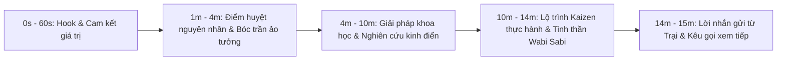

# ▶️ CHIẾN LƯỢC XÂY DỰNG & TĂNG TRƯỞNG KÊNH YOUTUBE BỀN VỮNG
> **Chịu trách nhiệm:** **Agent 10 (YouTube Master Strategist & Channel Manager)**  
> **Nguồn cảm hứng:** Kênh *The Gọn Life*, *Einzelgänger*, *Better Ideas*, kết hợp các repo GitHub hàng đầu (`Jakeschincariol/youtube-agent-skill`, `AgriciDaniel/claude-youtube`).

---

## 1. 🎯 BỘ 21 CÔNG THỨC HOOK 30 - 60 GIÂY ĐẦU CHO VIDEO DÀI
Theo dữ liệu YouTube, hơn 50% người xem sẽ rời bỏ video trong 60 giây đầu tiên (*The 60s Cliff*). Agent 10 bắt buộc áp dụng các công thức Hook đỉnh cao:

1. **The Inverted Paradox Hook (Nghịch lý đảo ngược):** Nêu một thực tế gây sốc trái ngược hoàn toàn với niềm tin số đông: *"Bạn nghĩ rằng mình mất tập trung là do thiếu kỷ luật? Không, bộ não bạn đang hoạt động quá hoàn hảo theo cơ chế sinh tồn..."*.
2. **The Vulnerable Story Arc (Mở đầu tự thú trần trụi):** Bắt đầu bằng một thất bại xấu hổ hoặc khoảnh khắc bế tắc tột cùng lúc 2h sáng trước khi đưa ra lối thoát.
3. **The Proof / Metric Hook (Con số và bằng chứng thực nghiệm):** *"Tiến sĩ Sahar Yousef tại Đại học UC Berkeley đã chứng minh: chỉ cần để chiếc điện thoại trong tầm mắt, não bạn tự động mất 10% năng lực tư duy..."*.
4. **The Stakes / Cost of Inaction (Cái giá của sự thờ ơ):** Chỉ ra tương lai đáng sợ nếu tiếp tục thói quen cũ: *"Nếu bạn không giành lại quyền kiểm soát dopamine trước năm 30 tuổi, đây là những gì sẽ xảy ra với trí nhớ ngắn hạn của bạn..."*.

---

## 2. 🎨 CẶP BÀI TRÙNG TIÊU ĐỀ & THUMBNAIL (TITLE & THUMBNAIL PAIRING LINTER)

Quy tắc bất di bất dịch của YouTube: **Tiêu đề và Thumbnail phải cộng hưởng và bổ sung cho nhau, tuyệt đối không lặp lại y hệt chữ của nhau!**

* **Thumbnail (Gợi mở sự tò mò / Cảm xúc thị giác):**
  * Dùng tranh màu nước Zen Watercolor ấm áp, góc tĩnh, gợi mở chiều sâu (ví dụ: góc bàn làm việc gỗ nhìn ra thành phố đêm, một tách trà bốc khói, chiếc điện thoại úp mặt).
  * **Text trên Thumbnail (tối đa 3 - 4 từ):** Gợi mở một câu hỏi nhức nhối hoặc một hình tượng lạ (*"Cú lừa 2h sáng", "Chữa rách?", "Vết nứt ánh sáng"*).
* **Tiêu đề Video (YouTube Title - Lời hứa giá trị & SEO):**
  * Độ dài tối ưu: **45 – 65 ký tự** (hiển thị trọn vẹn trên mobile).
  * Chứa từ khóa người dùng tìm kiếm + Lực hút tò mò:
    * *Vì Sao Bạn Càng Cố Kỷ Luật Lại Càng Thất Bại? (Giải Mã Từ Khoa Học Thần Kinh)*
    * *Chữa Lành Não Bộ Sau 1 Năm Lướt Video Ngắn: Giao Thức Focus Sprint 90 Phút*

---

## 3. 📈 NGHỆ THUẬT DUY TRÌ ĐỒ THỊ GIỮ CHÂN (AUDIENCE RETENTION ENGINEERING)

Để đồ thị giữ chân không bị dốc đứng đi xuống, kịch bản video 10–15 phút cần được chia thành 4 chặng có nhịp điệu thay đổi liên tục:

* **Quy tắc Pacing Shift (Đổi nhịp sau mỗi 2 phút):** Xen kẽ giữa giọng đọc tự sự trầm ấm, trích đoạn B-roll quay chậm, đồ thị minh họa đơn giản và câu hỏi mở giữa video.
* **Open Loops giữa video:** *"Ở phần 3, mình sẽ chỉ ra một sai lầm phổ biến mà 90% người cai nghiện điện thoại đều mắc phải..."*.

---

## 4. 🔍 GÓI YOUTUBE SEO & METADATA CHUẨN MỰC

1. **Mô tả video (Description):**
   * 3 dòng đầu: Tóm tắt giá trị cốt lõi (hiển thị trước nút "Xem thêm").
   * **Timestamps / Chapters đầy đủ:** Chia mốc thời gian rõ ràng (ví dụ: `00:00 - Giới thiệu`, `01:45 - Ảo tưởng đa nhiệm`...) giúp video xuất hiện trên Google Search Key Moments.
   * Danh sách 2-3 liên kết nội bộ: Link trắc nghiệm [traicainghien.com/trac-nghiem], link bài viết chuyên sâu và playlist liên quan.
2. **Thẻ Tags & Hashtags:** 
   * 3 hashtag chính đặt trong mô tả: `#TraiCaiNghien #TapTrungSau #DeepWork`.
   * Bộ tag YouTube SEO: `cai nghiện điện thoại`, `tập trung làm việc`, `dopamine reset`, `atomic habits`, `thói quen tốt`.
3. **Màn hình kết thúc (End Screen) & Thẻ (Cards):** Đặt video tiếp theo liên quan chặt chẽ theo dạng "Xem video này để hiểu tiếp về..." để tăng thời lượng xem toàn kênh (*Session Watch Time*).
