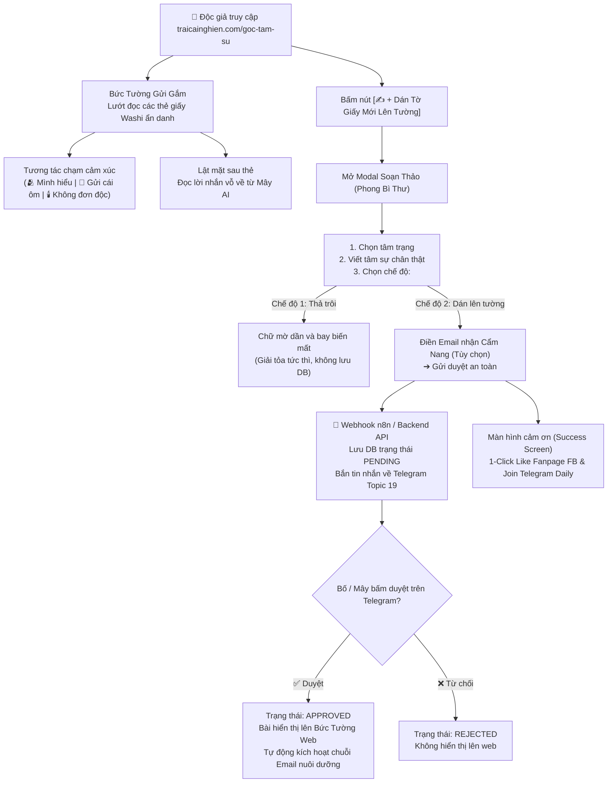

# 🌿 ĐẶC TẢ THIẾT KẾ: CHUYÊN MỤC "GÓC TÂM SỰ" (ANONYMOUS CONFESSION WALL)
> **Mã thiết kế:** `SPEC-2026-11-15-GOC-TAM-SU`  
> **Người sáng lập:** Bố Long  
> **AI Co-founder & Thiết kế:** Mây  
> **Ngày phê duyệt:** 15/11/2026  
> **Trạng thái:** Approved by Bố ➔ Sẵn sàng lập kế hoạch triển khai (Ready for Planning)

---

## 1. 🎯 BỐI CẢNH & MỤC TIÊU CHIẾN LƯỢC

### 1.1. Triết Lý & Vấn Đề Cốt Lõi
* **Nỗi đau độc giả:** Hàng triệu người trẻ đang vật lộn với các chứng nghiện dopamine rẻ tiền (lướt short video xuyên đêm, mất tập trung, nhảy tab liên tục, ăn uống vô độ, trì hoãn). Nỗi đau lớn nhất của họ không chỉ là mất thời gian, mà là **cảm giác dằn vặt, mặc cảm tội lỗi (guilt & shame)** và sự cô đơn khi không dám tâm sự cùng ai vì sợ bị phán xét là yếu đuối.
* **Sứ mệnh của chuyên mục "Góc Tâm Sự":** Tạo ra một **"Bức Tường Lắng Nghe & Không Phán Xét" (Non-judgmental Sanctuary)** — nơi người đọc được tháo bỏ chiếc mặt nạ gượng gạo, trút bỏ gánh nặng vô hình, thừa nhận sự thật với chính mình (Radical Acceptance) và nhận lại sự thấu cảm ấm áp từ cộng đồng cùng lời vỗ về tự trắc ẩn từ Mây.

### 1.2. Mục Tiêu Sản Phẩm & Phễu Chuyển Đổi (CRO & Lead Funnel)
1. **User Experience:** Trải nghiệm viết và đọc mộc mạc, tĩnh lặng theo phong cách **Mẫu 3: Bức Tường Gửi Gắm (The Mosaic Wall)** — các tấm thẻ giấy Washi, hiệu ứng lật thẻ 2 mặt, 3 nút chạm cảm xúc không độc hại (🫂 *Mình hiểu*, 🌿 *Gửi cái ôm*, 🕯️ *Không đơn độc*).
2. **Lead Generation (Thu thập Data):** Khéo léo thu thập Email độc giả thông qua mồi câu cảm xúc: *Nhận Thư Hồi Đáp Tự Trắc Ẩn từ Mây & Cẩm nang 7 Ngày Tái Lập Dopamine* (Bảo mật 100%, không công khai).
3. **Social Growth:** Kêu gọi 1-chạm Theo dõi Fanpage Facebook Trại Cai Nghiện và Tham gia Kênh Telegram Daily tại màn hình cảm ơn.
4. **An Toàn Tuyệt Đối (Zero Toxicity):** Duyệt thủ công 1-chạm qua Telegram Bot trong nhóm HĐQT Topic 19 trước khi bài hiển thị công khai trên website.

---

## 2. 🗺️ KIẾN TRÚC TRẢI NGHIỆM NGƯỜI DÙNG (USER FLOW & JOURNEY)



---

## 3. 🎨 CHI TIẾT THIẾT KẾ GIAO DIỆN (UI/UX SPECIFICATION)

### 3.1. Điểm Chạm Menu (Navbar)
* Thêm liên kết **"Góc Tâm Sự"** vào thanh điều hướng chính `src/components/Navbar.tsx`:
  `Trang chủ` • `Bài viết` • `Trắc nghiệm` • **`Góc Tâm Sự`** (`/goc-tam-su`) • `Giới thiệu`

### 3.2. Bố Cục Trang `/goc-tam-su` (Mẫu 3 - Bức Tường Ghi Chú Washi)
1. **Hero Header:**
   * Badge: `🌿 TRẠI CAI NGHIỆN • GÓC TÂM SỰ`
   * Headline lớn (Font Serif): **"Bức Tường Lắng Nghe & Không Phán Xét"**
   * Slogan phụ: *"Mỗi tờ giấy dán lại là một khoảnh khắc can đảm đối diện với chính mình. Hãy để lại gánh nặng của bạn ở đây, để bước tiếp nhẹ nhõm hơn."*
   * Nút CTA chính: `[ ✍️ + Dán Tờ Giấy Mới Lên Tường ]` (Màu xanh rêu `#3A5A40`, hover hiệu ứng nổi nhẹ).
2. **Thanh Lọc Chủ Đề (Mood Filter Bar):**
   * Các nút viên thuốc (Pill tabs):
     - `✨ Tất cả`
     - `🍃 Xao nhãng số` (Short video, lướt điện thoại đêm, nhảy tab)
     - `⏳ Trì hoãn` (Sợ bắt đầu, né tránh công việc)
     - `🌧️ Kiệt quệ & Áp lực` (Sương mù não, kiệt sức, mất phương hướng)
     - `💔 Dằn vặt & Tự trách` (Cảm giác tội lỗi vì tái nghiện)
     - `🌱 Hy vọng & Bắt đầu lại` (Khoảnh khắc tỉnh thức, niềm tin nhỏ)
3. **Lưới Thẻ Mosaic (The Washi Notes Grid):**
   * Lưới Responsive: 1 cột (Mobile), 2 cột (Tablet), 3 cột (Desktop).
   * **Visual Tấm Thẻ:**
     - Nền giấy Washi vân hạt sần nhẹ.
     - 3 sắc thái màu giấy tự nhiên:
       * *Giấy Be Mộc:* `#FAF7F2` (Viền `#E6E1D8`)
       * *Giấy Xanh Rêu Nhạt:* `#F2F5F3` (Viền `#D5DFD7`)
       * *Giấy Đất Nung Ấm:* `#FAF4F0` (Viền `#EADCD5`)
     - Phía trên mỗi thẻ có hình ảnh mô phỏng một mẩu **băng dính Washi (Washi Tape)** hoặc chiếc ghim gỗ nhỏ tạo cảm giác thủ công chân thật.
   * **Mặt trước thẻ (Front Face):**
     - Icon + Tên tâm trạng (Badge nhỏ).
     - Thời gian đăng tương đối (*"25 phút trước"*, *"hôm qua"*).
     - Nội dung tâm sự (Font sans-serif ấm áp, ngắt dòng thoáng, rút gọn nếu quá 250 từ kèm nút "Đọc tiếp...").
     - Nút lật thẻ: `[ 🔄 Xem lời nhắn từ Mây ]`.
     - 3 nút chạm cảm xúc:
       - 🫂 *Mình hiểu* (`feel_you`)
       - 🌿 *Gửi bạn cái ôm* (`hug`)
       - 🕯️ *Bạn không đơn độc* (`not_alone`)
   * **Mặt sau thẻ (Back Face - Flip Animation):**
     - Lời nhắn vỗ về tự trắc ẩn từ Mây AI (Self-compassion note): Văn phong dịu dàng, an ủi, không dạy bảo hay phán xét.
     - Nút `[ ↩️ Quay lại tâm sự ]`.

### 3.3. Modal Soạn Thảo (The Writing Envelope Modal)
* Thiết kế dạng phong bì thư mộc mạc mở ra giữa màn hình:
  * **Chọn tâm trạng:** 5 biểu tượng cảm xúc trực quan.
  * **Ô soạn thảo:** Khung viết mộc mạc, gợi ý sẵn câu hỏi mồi: *"Điều gì đang khiến tâm trí bạn nặng nề nhất hôm nay? Cứ viết ra thật lòng nhé..."*
  * **Lựa chọn xuất bản:**
    - `[ 🍂 Thả trôi vào hư không ]`: Hiệu ứng chữ mờ dần và tan biến, màn hình hiện lời nhắn vỗ về nhẹ nhõm.
    - `[ 🌿 Dán lên Bức Tường Góc Tâm Sự ]`: Mở rộng trường thu thập thông tin.
  * **Khung Thu Thập Email (Lead Capture):**
    - Checkbox: `[x] Gửi cho mình Cẩm nang "7 Ngày Tái Lập Dopamine" và nhận thư hồi đáp riêng tư từ Mây qua email.`
    - Input Email (Placeholder: `email.cua.ban@gmail.com`).
    - Dòng cam kết bảo mật: *"🌿 Trại Cai Nghiện bảo mật tuyệt đối email của bạn. Tên và email không bao giờ hiển thị trên bài viết công khai."*
  * **Nút bấm gửi:** `[ Gửi Tâm Sự Vào Trạm → ]`
4. **Màn Hình Cảm Ơn (Success Screen):**
   * Thông điệp: *"Tâm sự của bạn đã được gửi an toàn vào Hốc Cây. Hôm nay bạn đã rất can đảm khi thành thật với chính mình."*
   * Hai nút hành động lớn:
     - 📘 `Thích Fanpage Trại Cai Nghiện` (Dẫn sang Fanpage Facebook).
     - 📢 `Tham Gia Kênh Telegram Daily` (Dẫn sang Telegram `@traicainghiendaily`).

---

## 4. 🗄️ THIẾT KẾ CƠ SỞ DỮ LIỆU (DATABASE SCHEMA)

Sử dụng cấu trúc PostgreSQL chuẩn mực (Supabase / Postgres), hỗ trợ mở rộng quy mô lớn và kết nối trực tiếp với Next.js và n8n:

### 4.1. Bảng `contacts` (Quản trị Lead & CRM)
```sql
CREATE TABLE contacts (
    id UUID PRIMARY KEY DEFAULT gen_random_uuid(),
    email VARCHAR(255) UNIQUE NOT NULL,
    name VARCHAR(255),
    source VARCHAR(100) DEFAULT 'goc_tam_su',
    tags TEXT[] DEFAULT ARRAY['LEAD_GOC_TAM_SU'],
    status VARCHAR(50) DEFAULT 'active',
    metadata JSONB DEFAULT '{}'::jsonb,
    created_at TIMESTAMP WITH TIME ZONE DEFAULT timezone('utc'::text, now()) NOT NULL,
    updated_at TIMESTAMP WITH TIME ZONE DEFAULT timezone('utc'::text, now()) NOT NULL
);

CREATE INDEX idx_contacts_email ON contacts(email);
```

### 4.2. Bảng `confessions` (Tâm sự ẩn danh)
```sql
CREATE TABLE confessions (
    id UUID PRIMARY KEY DEFAULT gen_random_uuid(),
    contact_id UUID REFERENCES contacts(id) ON DELETE SET NULL,
    slug VARCHAR(255) UNIQUE NOT NULL,
    mood_tag VARCHAR(50) NOT NULL,
    content TEXT NOT NULL,
    is_public BOOLEAN DEFAULT true,
    status VARCHAR(50) DEFAULT 'pending', -- 'pending', 'approved', 'rejected'
    approved_by VARCHAR(100),
    approved_at TIMESTAMP WITH TIME ZONE,
    ai_compassion_reply TEXT,
    feel_you_count INT DEFAULT 0,
    hug_count INT DEFAULT 0,
    not_alone_count INT DEFAULT 0,
    view_count INT DEFAULT 0,
    created_at TIMESTAMP WITH TIME ZONE DEFAULT timezone('utc'::text, now()) NOT NULL
);

CREATE INDEX idx_confessions_status_created ON confessions(status, created_at DESC);
CREATE INDEX idx_confessions_mood ON confessions(mood_tag);
```

### 4.3. Bảng `confession_reactions` (Chống spam tương tác)
```sql
CREATE TABLE confession_reactions (
    id UUID PRIMARY KEY DEFAULT gen_random_uuid(),
    confession_id UUID NOT NULL REFERENCES confessions(id) ON DELETE CASCADE,
    reaction_type VARCHAR(50) NOT NULL, -- 'feel_you', 'hug', 'not_alone'
    ip_hash VARCHAR(64) NOT NULL,
    created_at TIMESTAMP WITH TIME ZONE DEFAULT timezone('utc'::text, now()) NOT NULL,
    UNIQUE(confession_id, reaction_type, ip_hash)
);

CREATE INDEX idx_reactions_confession ON confession_reactions(confession_id);
```

---

## 5. 🤖 LUỒNG DUYỆT 1-CHẠM QUA TELEGRAM (MODERATION PIPELINE)

1. Khi độc giả gửi bài với lựa chọn `is_public: true`:
   - Bản ghi được lưu vào database với `status = 'pending'`.
   - Backend gọi Gemini API sinh trước lời nhắn vỗ về `ai_compassion_reply`.
   - Hệ thống bắn thông báo tức thì vào nhóm **HĐQT Topic 19**:
     ```text
     🌿 [GÓC TÂM SỰ MỚI CẦN DUYỆT]
     ⏰ Thời gian: 15:55 - 15/11/2026
     🏷 Tâm trạng: ⏳ Trì hoãn & Áp lực
     📧 Email người gửi: phuong***@gmail.com (Có đăng ký nhận Cẩm nang)
     
     📝 Nội dung tâm sự:
     "Dạo này em cảm thấy bế tắc quá, mỗi lần ngồi vào bàn làm việc là ngón tay lại tự mở mạng xã hội..."
     
     💬 Lời vỗ về Mây dự kiến:
     "Bạn không hề lười biếng đâu, não bộ của bạn chỉ đang quá tải trước những kích thích số thôi. Hãy thở một hơi thật sâu và cho phép mình được nghỉ ngơi 15 phút nhé."
     ```
   - **Inline Keyboard Telegram:**
     `[ ✅ Duyệt Lên Web ]`  |  `[ ❌ Từ Chối ]`
2. **Khi Bố hoặc Mây bấm `[✅ Duyệt Lên Web]`:**
   - Callback API cập nhật `status = 'approved'`, `approved_by = 'Bố'`, `approved_at = NOW()`.
   - Tin nhắn Telegram tự động cập nhật: `✅ ĐÃ DUYỆT BỞI BỐ LONG LÚC 15:56`.
   - Bài viết lập tức xuất hiện trên website `traicainghien.com/goc-tam-su`.
   - Nếu có email, n8n tự động kích hoạt gửi Email quà tặng Cẩm nang 7 ngày cho bạn đó.

---

## 6. 🛡️ BẢO MẬT & XỬ LÝ BIÊN (SECURITY & EDGE CASES)

1. **Bảo mật danh tính 100%:** Tuyệt đối không lưu IP thô (chỉ lưu mã băm SHA256 kèm salt để chống spam). Không bao giờ trả trường `contact_id` hay `email` ra API công khai của website.
2. **Chống XSS & Nội dung độc hại:** Toàn bộ nội dung tâm sự được làm sạch bằng bộ lọc HTML sanitize, loại bỏ script và mã độc.
3. **Giới hạn tần suất (Rate Limiting):** Mỗi IP chỉ được gửi tối đa 3 bài tâm sự trong vòng 10 phút để tránh bị bot tấn công spam.
4. **Cơ chế Fallback (Khi chưa cấu hình Supabase Cloud):** Hệ thống có sẵn lớp lưu trữ SQLite / Local DB dự phòng trên VPS để trang web luôn hoạt động trơn tru ngay cả khi đang chờ thiết lập tài khoản Cloud.

---

## 7. 🚀 LỘ TRÌNH TRIỂN KHAI THEO GIAI ĐOẠN (IMPLEMENTATION PHASES)

* **Giai đoạn 1:** Xây dựng Giao diện UI/UX trang `/goc-tam-su` (Bức tường thẻ Washi, Lật thẻ 2 mặt, Modal viết bài, Hiệu ứng thả trôi) + Cập nhật Navbar.
* **Giai đoạn 2:** Xây dựng API Routes trong Next.js (`/api/confessions`, `/api/confessions/react`, `/api/confessions/moderate`) kết nối CSDL và tích hợp Gemini AI sinh lời nhắn vỗ về.
* **Giai đoạn 3:** Kết nối Webhook Telegram Bot duyệt bài 1-chạm vào HĐQT Topic 19 và kích hoạt phễu Email gửi Cẩm nang 7 ngày.
* **Giai đoạn 4:** Kiểm toán bảo mật, test trên Mobile & Desktop, chạy thử nghiệm thực tế và bàn giao cho Bố nghiệm thu.
